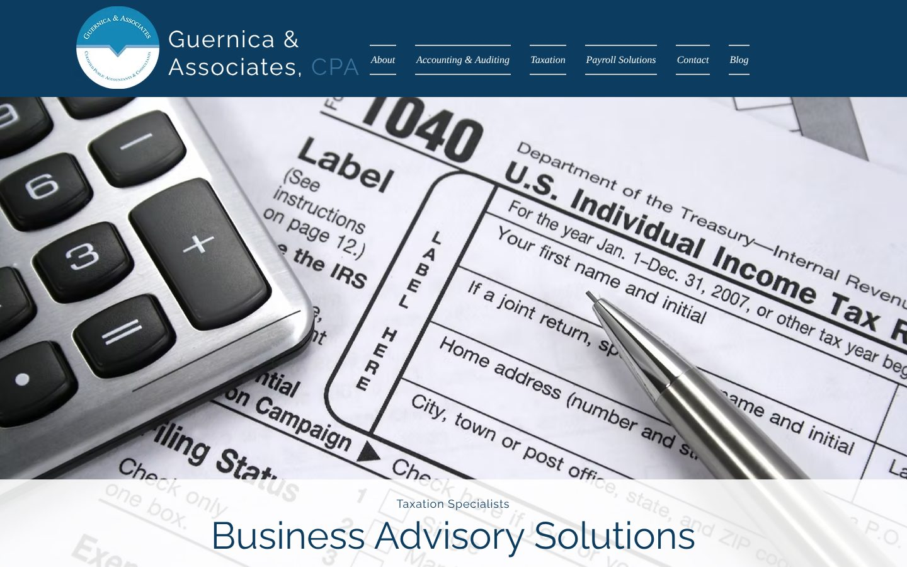
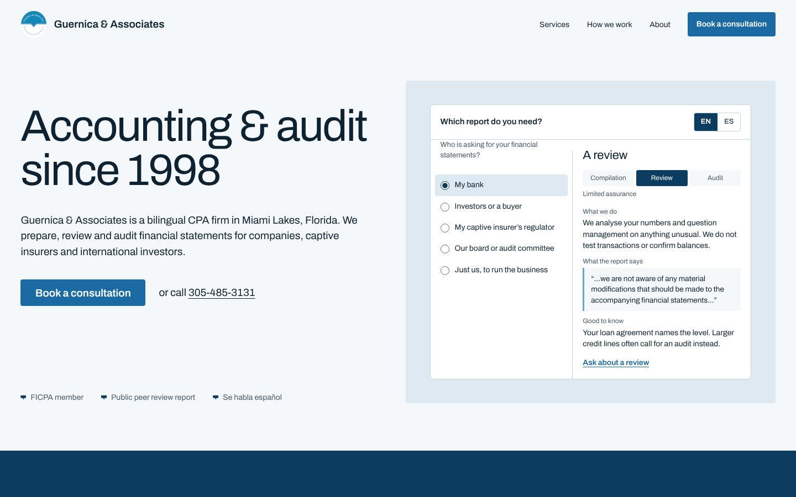

# Guernica & Associates, CPA: design audit and redesign

Audited: https://www.guernicacpa.com/ (homepage), 30 Oct 2026, using tasteskill v2 (`Leonxlnx/taste-skill`): its browser inspector at 1440, 768 and 390px, and its juror critique.

## Verdict

The current site hides an accounting and audit practice behind a stock tax-form photo, an off-topic headline ("Business Advisory Solutions") and a layout that does not work on phones. The redesign leads with what the firm actually signs: compilations, reviews and audits.

| | Before | After |
| --- | --- | --- |
| Inspector result | 8 FAIL, 5 WARN | 0 FAIL, 1 WARN |
| Juror score (of 10) | 4.3 | 7.4 |
| Phone layout | Desktop page shrunk to 980px; tablet scrolls sideways 212px | Own phone composition, no sideways scroll |
| First-screen title | "Business Advisory Solutions" under a "Taxation Specialists" label | "Accounting & audit since 1998" |
| Primary action on first screen | None | "Book a consultation" button and phone number |
| Typefaces | 3 (Open Sans, Raleway, Georgia) | 1 (Archivo) |
| Text shadows | 23 | 0 |
| Unreadable text (measured) | 4 blocks at 1:1 contrast | 0 |
| Words of real content | 347 | about 800 |

 

## What is wrong today (ranked)

1. **Not mobile-ready.** The page renders at 980px on a 390px phone, so visitors pinch and zoom. At tablet width it scrolls sideways and the "CPA" title is half covered.
2. **The wrong story.** The hero is a 2007 IRS Form 1040 with a calculator and says "Taxation Specialists". The firm's own pages say its core is accounting and audit.
3. **No clear next step.** No button above the fold. The only actions are three identical "More Info" buttons.
4. **Template look.** Three identical navy cards with centred small text, a centred "ABOUT US" wall of text, and a footer that is mostly empty navy.
5. **Legibility.** 23 text shadows, light-on-light text, three typefaces, and body text at 1.2 line height.
6. **Strengths buried.** Bilingual service, captive insurers and international investors, the peer review report and the FICPA membership sit in paragraphs or as small badges at the bottom.

## The redesign

- **Idea:** the three levels of assurance the firm signs (compilation, review, audit) become a working engagement picker on the first screen.
- **Live thing:** "Who is asking for your financial statements?" Pick bank, investors, captive insurance regulator, board, or just you. It shows the engagement, the assurance level, what the CPA does, the actual report wording, and a link to ask about it. One tap switches it to Spanish.
- **Signature move:** "How an audit runs here" pins an example audit request list that moves from Requested to Received to Tested as you scroll.
- **Pictures:** the firm's own office photos and credentials, plus two credited open-licence photos (Miami Lakes, a ledger).
- **Brand kept:** navy and logo blue; the notched chevron from the door sign and logo is the one shape used across the page.

## Critique, final round

```
ROUND 2
Seen in one second: "Accounting & audit since 1998" beside a working report picker
Idea (one sentence): the three levels of assurance become a picker that answers "which report do I need?"
Live thing: bilingual engagement picker (5 situations, EN/ES)
Layout words by section: hero=split+fragment / approach=pinned list / services=shaped photo+points / clients=two lists / place=full-bleed photo / about=letter on ledger / proof=tiles / contact=band / footer=strip
Scores: design 7 · usability 8 · creativity 7 · content 7.5 → overall 7.4
Caps applied: creativity capped at 7 (another audit firm could use a similar picker; bilingual and captive content make it specific, not unique)
```

Still short of the best: no video (no honest footage of the firm's work exists), and the services and clients sections are tidy rather than memorable. A real photo of the team at work would lift both.

## Confirm with the firm before launch

- The **audit request list** in "How an audit runs here" is an example. Items and wording should match their real request list.
- **Picker wording:** the report excerpts follow standard AICPA report language. The firm should approve each situation's advice (especially captive insurers and loan covenants) and the Spanish text.
- **Peer review link** points to their current Accounting & Auditing page, where the report is posted.
- **Credits:** two photos are CC BY-SA 4.0 and are credited in the footer. Keep the credit line if they stay.

## Files

- `index.html`: the redesigned homepage (single file, no build step)
- `img/`: the firm's own logo, office photos and credential badges, taken from the current site
- `assets/`: open-licence photos with `credits.json`
- `audit/`: before and after screenshots
